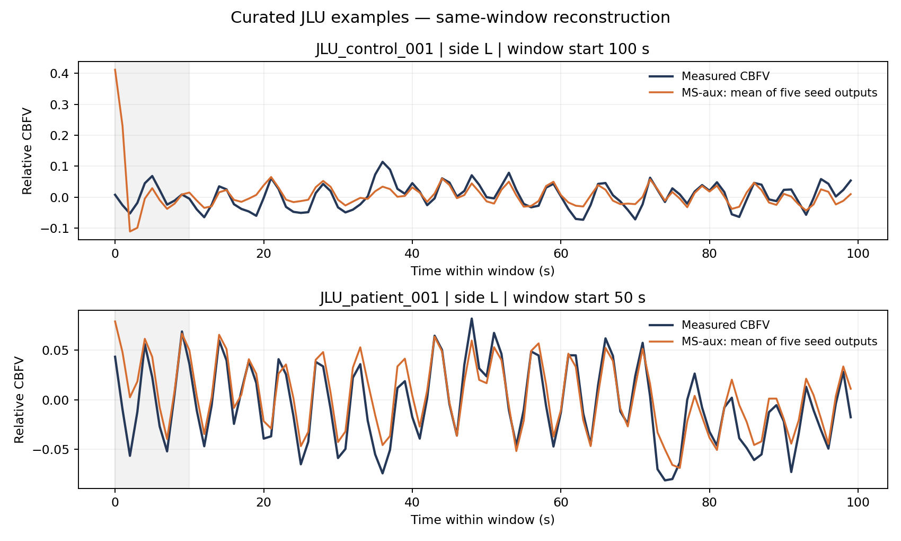

# Surrogate dCA CVAE

Code, 20 frozen model checkpoints, and small example datasets for **Toward Digital Twin–Enabled Assessment of Dynamic Cerebral Autoregulation: Learning From Surrogate Pressure–Flow Data**.

The model learns from recorded arterial blood pressure (ABP) paired with Tiecks-simulated cerebral blood flow velocity (CBFV). Frozen encoders characterize measured recordings, and decoders generate responses to prescribed pressure probes. The four matched configurations are M (waveform CVAE), S (step VAE), S-Y (step VAE plus waveform decoder), and MS (joint model). MS-main and MS-aux are two inference routes through the same MS weights.

## Included data

| Dataset | Included | Purpose |
|---|---:|---|
| Surrogate pairs | **11,610 / 393,700 = 2.95%**, 210 source records | Training and evaluation examples; original train/validation/test membership retained |
| JLU controls | **1 participant**, 12 windows | Curated reconstruction and TFA example |
| JLU patients | **1 participant**, 5 windows | Curated reconstruction and TFA example |
| Model weights | **4 configurations × 5 seeds = 20 checkpoints** | Frozen inference without training or downloading |

JLU examples were selected for favorable same-window reconstruction using the five frozen MS-aux models. They use new example IDs and contain no original file paths or participant identifiers. They are illustrative examples; two people cannot estimate clinical AUC. See [selection details](data/demo/selection_manifest.json).

**For the full real/clinical dataset and access arrangements, contact [hx.yang2@siat.ac.cn](mailto:hx.yang2@siat.ac.cn).** See [data access](docs/data_access.md).

## Install and run

Use Python 3.10 or later. The pinned environment was checked with Python 3.10.19; the default demo runs on CPU.

```bash
git clone https://github.com/SQDS/surrogate-dca-cvae.git
cd surrogate-dca-cvae
python -m venv .venv
source .venv/bin/activate
python -m pip install -r requirements.txt
python scripts/download_weights.py
python scripts/run_demo.py
```

The demo writes `outputs/demo/jlu_reconstruction.png`, `jlu_tfa.png`, numerical tables, and `run.json`. It runs all five MS seeds, conventional TFA, model sinusoidal probes, and a surrogate cross-window forecast. It does not update the frozen weights.



The plot shows a window near the median reconstruction correlation within each selected participant. The shaded first 11 samples are excluded from the reported MSE and correlation. The displayed prediction averages the five seed outputs; tabulated metrics average the five individual-model scores. [TFA preview](docs/demo_tfa.png).

```bash
# All four configurations and five seeds, on the bundled surrogate test subset.
python scripts/evaluate.py --out outputs/evaluation
python scripts/plot_results.py --input outputs/evaluation

# Short execution check for all four training configurations.
python scripts/train_models.py --smoke --seeds 42 --out outputs/training_smoke

# Training on the included 2.95% subset (new models, not paper-model reproduction).
python scripts/train_models.py --device cuda:0 --out outputs/subset_training

# With complete datasets obtained separately, using data/schema.json.
python scripts/train_models.py --data data/private/surrogate_full.npz --device cuda:0 --out outputs/full_training
python scripts/evaluate.py --task classification --data data/private/jlu_full.npz --out outputs/clinical
```

`train_models.py` defaults to 400 epochs, four configurations, and seeds 42–46. Checkpoint selection uses validation cross-window relative MSE on samples 11:100; the earlier saved epoch wins exact ties. There is no early stopping in this release's four-configuration protocol. Training on the example subset cannot reproduce results from the full dataset. The supplied weights are the original selected model tensors, repackaged without optimizer history.

## Layout

```text
configs/      model, preprocessing, evaluation and statistical settings
src/          models, losses, preprocessing, FIR, TFA, reconstruction,
              participant-level classification and statistical functions
simulation/   MATLAB Tiecks data generator
scripts/      demo, weight verification/download, training, evaluation, plots
weights/      20 portable checkpoints and their SHA256 manifest
data/demo/    surrogate subset, two JLU examples and selection metadata
results/      aggregate reference results from the full archived experiment
docs/         model card, data access, provenance and validation notes
```

The MATLAB generator accepts explicit input/output directories and requires the original `Part_*.mat` ABP source files and MATLAB Signal Processing Toolbox. From MATLAB, add `simulation` to the path and call:

```matlab
generate_surrogate(100, '/path/to/source_abp', '/path/to/generated_output')
```

## Reference results and interpretation

`results/reference_summary.csv` contains the full-experiment reference values. Joint MS-aux GP6 AUC is 0.9515, compared with 0.9145 for conventional TFA GPC9; the paired comparison did not establish superiority. The bundled examples are smaller than the original 139-person cohort and 59,080-pair surrogate test set. Their computed values must not be reported as the full paper results.

Signals are dimensionless relative perturbations, sampled at 1 Hz in 100-point windows. The frozen training-only global scaler is stored in `configs/models.json`. The auxiliary input is a 12-point cumulative FIR response in standardized coordinates. TFA gain is exported in relative output/input units, and phase is in degrees. See [data schema](data/schema.json) and [model card](docs/model_card.md).

## License and citation

Code is released under the [MIT License](LICENSE), selected by the author for this package. See [CITATION.cff](CITATION.cff) for the software citation and repository URL. The manuscript title is recorded, but no unverified DOI or author list has been inserted. Contact [hx.yang2@siat.ac.cn](mailto:hx.yang2@siat.ac.cn) for the current manuscript citation and data access.

## 中文快速说明

已按 `github架构.txt` 整理。包含模拟数据 **2.95%**、JLU 正常与患者**各一人**、四配置五种子的 **20 个正式权重**。运行 `python scripts/run_demo.py` 即可生成示例重建图和 TFA 图。完整真实数据请联系 **hx.yang2@siat.ac.cn**。示例选取依据、实际比例和运行验证记录均随包提供。
